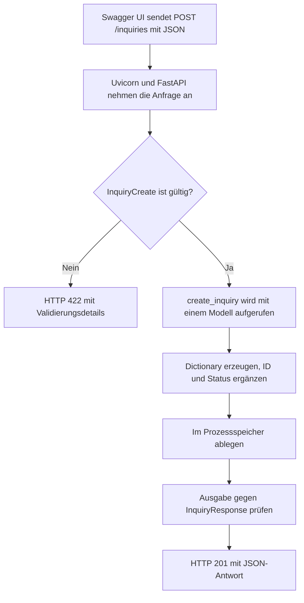

# Eine FastAPI-Anwendung Schritt für Schritt verstehen

Diese Anleitung begleitet dich durch das vorhandene Projekt. Du lernst, warum die einzelnen Bausteine gebraucht werden, wo sie liegen, wie sie zusammenarbeiten und wann du sie verändern würdest.

Du brauchst erste Python-Grundlagen: Variablen, Funktionen, Listen und Dictionaries. Klassen, Vererbung und Typannotationen werden am konkreten Beispiel erklärt. Die Codeausschnitte sind Ausschnitte aus dem vorhandenen Projekt; du musst die Dateien dafür nicht überschreiben.

## 1. Problem verstehen

Eine Person möchte eine Küchenberatung anfragen. Dafür werden vier Angaben benötigt:

- Wie heißt die Person?
- In welchem Postleitzahlgebiet wohnt sie?
- Welche Küchenform interessiert sie?
- Welches Budget steht zur Verfügung?

Wenn diese Angaben als beliebiger Freitext eingehen, muss jemand sie nachträglich ordnen und auf Vollständigkeit prüfen. Eine API kann dafür feste Datenfelder und Regeln bereitstellen.

**Ziel dieses Projekts:** Eine Anfrage als JSON entgegennehmen, prüfen, mit einer ID und dem Status `neu` versehen und später wieder abrufen.

Eine API ist eine vereinbarte Schnittstelle zwischen Programmen. Später könnte beispielsweise ein Website-Formular diese Schnittstelle aufrufen. Im jetzigen Projekt übernimmt Swagger UI die Rolle des Clients, mit dem du die API ausprobieren kannst. Ein eigenes Frontend und eine Datenbank sind bisher nicht vorhanden.

**Lernkontrolle:** Kannst du in eigenen Worten erklären, welche vier Angaben eine Anfrage benötigt und welche zwei Angaben der Server ergänzt?

## 2. Systemkontext verstehen

### Welche Datei hat welche Aufgabe?

| Ort | Aufgabe | Wann schaust du hier nach? |
| --- | --- | --- |
| [requirements.txt](../../requirements.txt) | Nennt die benötigten Python-Pakete. | Ein Paket fehlt oder du richtest das Projekt neu ein. |
| `app/__init__.py` | Kennzeichnet `app` als reguläres Python-Paket; die Datei ist hier leer. | Du prüfst die Paketstruktur oder einen Importfehler. |
| [app/schemas.py](../../app/schemas.py) | Definiert Datenmodelle und Validierungsregeln. | Felder oder erlaubte Werte sollen sich ändern. |
| [app/main.py](../../app/main.py) | Erstellt die FastAPI-App und enthält Endpunkte, Logik und Speicher. | Du untersuchst einen API-Aufruf oder ergänzt eine Funktion. |
| [README.md](../../README.md) | Beschreibt Überblick, Einrichtung und Verwendung. | Du möchtest das Projekt schnell starten oder vorstellen. |
| `docs/learning/` | Enthält diese vertiefende Lernanleitung. | Du möchtest Zusammenhänge nachvollziehen und üben. |

### Welche Werkzeuge arbeiten zusammen?

| Werkzeug | Rolle im Projekt |
| --- | --- |
| Python | Führt den Anwendungscode aus. |
| FastAPI | Verknüpft HTTP-Aufrufe mit Python-Funktionen und nutzt die Modelle zur Ein- und Ausgabeprüfung. |
| Pydantic | Erstellt aus Eingabedaten typisierte Modelle und prüft deren Regeln. |
| Uvicorn | Nimmt als ASGI-Server HTTP-Anfragen entgegen und führt die FastAPI-App aus. |
| Swagger UI | Stellt im Browser eine Oberfläche zum Lesen und Ausprobieren der API bereit. |

Die Rollen sind wichtig: FastAPI ist das Webframework, Uvicorn der Serverprozess und Pydantic die Modell- und Validierungsbibliothek.

### Wie sehen die Schichten tatsächlich aus?

Das Projekt trennt die Datenverträge in `schemas.py` von den Endpunkten in `main.py`. Geschäftslogik und Speicherung liegen derzeit ebenfalls in `main.py`. Eine eigene Service-Schicht oder Repository-Schicht gibt es noch nicht.

Wenn später mehrere Endpunkte dieselbe Geschäftsregel verwenden, kann eine Service-Schicht sinnvoll werden. Wenn die Speicherung auf eine Datenbank umgestellt wird, kann eine eigene Datenzugriffsschicht helfen. Für den aktuellen Umfang lässt sich der Ablauf direkt in zwei Dateien verfolgen.

## 3. Lösung verstehen

### So läuft eine neue Anfrage durch das System



Die Prüfung der Eingabe passiert vor dem Aufruf deiner Endpunktfunktion. Bei einer ungültigen Anfrage wird `create_inquiry` nicht ausgeführt. Eine gültige Antwort enthält zusätzlich `id` und `status`.

### Warum gibt es mehrere Endpunkte?

| Absicht | Aufruf | Eingabestelle |
| --- | --- | --- |
| Eine Anfrage anlegen | `POST /inquiries` | JSON im Request-Body |
| Alle Anfragen lesen | `GET /inquiries` | Keine zusätzliche Eingabe nötig |
| Eine Auswahl lesen | `GET /inquiries?postal_code=70` | Query-Parameter hinter `?` |
| Eine bestimmte Anfrage lesen | `GET /inquiries/1` | ID als Teil des Pfades |
| Alle fachlichen Angaben ersetzen | `PUT /inquiries/1` | ID im Pfad und vollständiger JSON-Body |
| Einzelne Angaben ändern | `PATCH /inquiries/1` | ID im Pfad und nur die zu ändernden Felder im Body |
| Eine Anfrage löschen | `DELETE /inquiries/1` | ID im Pfad; kein Body nötig |

POST, PUT, PATCH und DELETE verändern hier den Zustand des Systems. GET liest Daten. Die Kombination aus HTTP-Methode und Pfad bestimmt, welche Funktion FastAPI aufruft.

## 4. Dateien und Code konkret durchgehen

### Schritt 1: Die Python-Umgebung vorbereiten

**Warum?** Das Projekt benötigt Pakete, die nicht zur Python-Standardbibliothek gehören. Eine virtuelle Umgebung hält diese von anderen Projekten getrennt.

**Wo?** Öffne in VS Code den Projektordner. Das Terminal muss in dem Ordner stehen, der `app/` und `requirements.txt` enthält.

**Wie?** Unter Windows / PowerShell:

```powershell
python -m venv .venv
.\.venv\Scripts\python.exe -m pip install -r requirements.txt
```

Wenn `.venv` bereits eingerichtet ist, brauchst du sie nicht erneut anzulegen. Der zweite Befehl installiert die Abhängigkeiten aus [requirements.txt](../../requirements.txt).

- `python -m venv .venv` erstellt die virtuelle Umgebung.
- Der direkte Pfad zu `python.exe` wählt genau diese Umgebung aus; eine vorherige Aktivierung ist nicht nötig.
- `-m pip` startet `pip` mit diesem Python-Interpreter.
- `-r requirements.txt` liest die zu installierenden Pakete aus der Datei.

In VS Code wählst du über **Python: Select Interpreter** ebenfalls `.venv\Scripts\python.exe`, damit Editor und Terminal dieselbe Umgebung verwenden.

Die Angaben wie `fastapi>=0.110.0` sind Mindestversionen. Die Datei fixiert damit keine exakt reproduzierbare Paketkombination.

### Schritt 2: Erlaubte Küchenformen festlegen

**Warum?** Ein gemeinsamer Satz von Werten verhindert unterschiedliche Schreibweisen wie `L-Küche`, `LForm` und `l_form` in den Daten.

**Wo?** In [schemas.py](../../app/schemas.py), Klasse `KitchenType`:

```python
class KitchenType(str, Enum):
    ZEILE = "zeile"
    L_FORM = "l_form"
    INSEL = "insel"
```

**Wie?** Ein `Enum` beschreibt eine begrenzte Menge benannter Werte. `L_FORM` ist der Name im Python-Code, `"l_form"` der zugehörige Wert in der JSON-Schnittstelle. Durch die Kombination mit `str` lassen sich die Werte als Zeichenketten darstellen.

**Wann ändern?** Wenn eine weitere Küchenform fachlich unterstützt werden soll. Eine neue Auswahl muss dann auch von Clients und Beispielen berücksichtigt werden.

### Schritt 3: Gemeinsame Felder und Regeln definieren

**Warum?** Eingabe und Ausgabe enthalten dieselben fachlichen Angaben. Eine gemeinsame Basis vermeidet doppelte Felddefinitionen.

**Wo?** In `InquiryBase` in [schemas.py](../../app/schemas.py):

```python
class InquiryBase(BaseModel):
    customer_name: str = Field(..., min_length=2, max_length=100)
    postal_code: str = Field(
        ..., min_length=5, max_length=5, pattern=r"^[0-9]{5}$"
    )
    kitchen_type: KitchenType = Field(...)
    budget: float = Field(..., gt=0)
```

Der Ausschnitt lässt die Beschreibungen aus der Quelldatei weg, damit die Regeln leichter sichtbar sind.

- `BaseModel` gibt der Klasse die Pydantic-Funktionen zur Validierung und Modellverarbeitung.
- `customer_name: str` ist eine Typannotation. Pydantic verwendet diese Information zur Laufzeit; eine gewöhnliche Python-Typannotation allein würde keine Eingabedaten prüfen.
- `Field(...)` kennzeichnet hier ein Pflichtfeld. Die drei Punkte sind das Python-Objekt `Ellipsis`, kein Platzhalter zum Ausfüllen.
- `min_length` und `max_length` beschränken die Zeichenanzahl.
- `pattern=r"^[0-9]{5}$"` verlangt genau fünf Ziffern: `^` steht für den Anfang, `$` für das Ende, `[0-9]` für eine Ziffer und `{5}` für fünf Wiederholungen.
- `gt=0` bedeutet „greater than zero“: Das Budget muss größer als null sein.

**Warum ist die PLZ ein String?** Mit einer Postleitzahl wird nicht gerechnet. Bei `"01067"` muss die führende Null erhalten bleiben.

**Was wird damit nicht geprüft?** Fünf Ziffern beweisen nicht, dass die Postleitzahl tatsächlich existiert. Zwei Zeichen beweisen nicht, dass ein Kundenname sinnvoll ist. Technische Validierung bildet nur die ausdrücklich definierten Regeln ab.

### Schritt 4: Eingabe und Ausgabe unterscheiden

**Wo?** Ebenfalls in [schemas.py](../../app/schemas.py):

```python
class InquiryCreate(InquiryBase):
    pass


class InquiryResponse(InquiryBase):
    id: int
    status: str = "neu"
```

**Wie?** Beide Klassen erben die vier Felder von `InquiryBase`. `pass` bedeutet, dass `InquiryCreate` momentan keine weiteren Felder oder Methoden ergänzt. Der eigene Klassenname beschreibt trotzdem eine klare Rolle: die Eingabe beim Anlegen.

`InquiryResponse` ergänzt eine ID und einen Status. `id: int` ist ein Pflichtfeld; `status` hat den Standardwert `"neu"`.

**Warum?** Der Client liefert die fachlichen Angaben. Der Server bestimmt ID und Bearbeitungsstatus. Das macht die Verantwortlichkeiten in der Schnittstelle sichtbar.

**Wichtig für das tatsächliche Verhalten:** Zusätzliche Eingabefelder werden in der aktuellen Pydantic-Konfiguration standardmäßig ignoriert. Sendet jemand `id` oder `status` im Request-Body mit, werden diese Werte nicht übernommen; der Server setzt seine eigenen Werte. Die Anfrage wird deswegen aber nicht automatisch abgelehnt.

Die vorhandene Einstellung `Config.from_attributes = True` erlaubt dem Modell zusätzlich das Lesen von Objektattributen. Für die aktuell zurückgegebenen Dictionaries ist sie nicht erforderlich. Sie erzeugt keine Datenbankanbindung.

### Schritt 5: Die App und ihren Speicher anlegen

**Wo?** Am Anfang von [main.py](../../app/main.py):

```python
from app.schemas import InquiryCreate, InquiryResponse

app = FastAPI(
    title="Anfrage- und Beratungs-Workflows API",
    description="Backend-Schnittstelle zur Erfassung und Abfrage von Beratungsanfragen",
    version="1.0.0"
)

db_inquiries: dict[int, dict] = {}
id_counter = 1
```

**Wie?** Der Import macht die Datenmodelle in `main.py` verfügbar. Das Objekt `app` verwaltet die Endpunkte. Titel, Beschreibung und Version erscheinen in der API-Dokumentation.

`db_inquiries` ist ein Dictionary: Die Schlüssel sind numerische IDs, die Werte sind Dictionaries mit Anfragedaten. `id_counter` liefert die nächste ID.

**Warum so einfach?** Du kannst den vollständigen Datenfluss nachvollziehen, ohne vorher eine Datenbank einzurichten.

**Wann reicht das nicht mehr?** Sobald Daten Neustarts überleben müssen oder mehrere Prozesse dieselben Daten verwenden sollen. Der Zähler ist außerdem keine verlässliche ID-Vergabe für parallele Schreibzugriffe. Dafür braucht es eine geeignete persistente Speicherung und kontrollierte Schreiboperationen.

### Schritt 6: Eine Anfrage anlegen

**Wo?** Funktion `create_inquiry` in [main.py](../../app/main.py):

```python
@app.post(
    "/inquiries",
    response_model=InquiryResponse,
    status_code=status.HTTP_201_CREATED,
    tags=["Anfragen"]
)
def create_inquiry(inquiry_in: InquiryCreate):
    global id_counter

    new_data = inquiry_in.model_dump()
    new_data["id"] = id_counter
    new_data["status"] = "neu"

    db_inquiries[id_counter] = new_data
    id_counter += 1

    return new_data
```

**Wie liest du das von oben nach unten?**

1. Der Decorator `@app.post(...)` registriert die Funktion für `POST /inquiries`.
2. `inquiry_in: InquiryCreate` sagt FastAPI, welches Modell für den Request-Body verwendet werden soll.
3. Bei gültiger Eingabe erhält die Funktion ein `InquiryCreate`-Objekt.
4. `model_dump()` erzeugt daraus ein Python-Dictionary. Das ist noch kein JSON-Text.
5. Die aktuelle ID und der Status `neu` werden ergänzt.
6. Das Dictionary wird unter seiner ID im Speicher abgelegt.
7. Der Zähler wird für die nächste Anfrage erhöht.
8. FastAPI verwendet `InquiryResponse`, um die Ausgabe zu validieren und zu serialisieren, und sendet bei Erfolg HTTP `201` mit JSON zurück.

`global id_counter` ist nötig, weil `id_counter += 1` der Variablen einen neuen Wert zuweist. Ohne `global` würde Python sie in dieser Funktion als lokale Variable behandeln. `db_inquiries[...] = ...` verändert dagegen das vorhandene Dictionary und bindet den Namen `db_inquiries` nicht neu.

`response_model` prüft die Ausgabe. Es erzeugt keine ID und speichert keine Daten. Diese Aufgaben erledigt der Funktionscode. Passt die Rückgabe nicht zum Ausgabemodell, ist das ein Serverfehler, kein Validierungsfehler der Client-Eingabe.

### Schritt 7: Alle Anfragen lesen und filtern

**Wo?** Funktion `get_all_inquiries` in [main.py](../../app/main.py).

Der Decorator verwendet `@app.get("/inquiries", response_model=list[InquiryResponse], ...)`. Die Ausgabe ist deshalb eine Liste von Anfragen, auch wenn nur ein Treffer vorhanden ist.

```python
postal_code: Optional[str] = Query(
    default=None,
    min_length=2,
    max_length=5,
    description="Filter nach PLZ oder PLZ-Präfix"
)
```

**Wie?** `Optional[str]` bedeutet `str` oder `None`. `default=None` erlaubt, den Parameter wegzulassen. `Query` beschreibt und validiert den Parameter aus der URL.

Der Funktionskörper liest den Speicher:

```python
items = list(db_inquiries.values())
if postal_code:
    return [i for i in items if i["postal_code"].startswith(postal_code)]
return items
```

- `.values()` liefert die gespeicherten Anfragedaten ohne die Dictionary-Schlüssel.
- `list(...)` macht daraus eine Liste.
- Die List Comprehension baut eine neue Liste mit passenden Einträgen.
- `.startswith("70")` trifft beispielsweise auf `"70173"` zu.

**Wann verwenden?** Wenn du alle Anfragen sehen oder eine regionale Auswahl treffen möchtest.

Anders als das PLZ-Feld im Body prüft dieser Query-Parameter aktuell nur die Länge, kein Ziffernmuster. `?postal_code=ab` ist daher zulässig und liefert bei den vorhandenen Datenregeln eine leere Liste. `?postal_code=7` führt wegen der Mindestlänge zu HTTP `422`.

### Schritt 8: Eine bestimmte Anfrage lesen

**Wo?** Funktion `get_inquiry` in [main.py](../../app/main.py).

```python
inquiry_id: int = Path(..., gt=0, description="Eindeutige ID der Anfrage")
```

**Wie?** FastAPI liest die ID aus `/inquiries/{inquiry_id}`, wandelt sie in einen Integer um und prüft, ob sie größer als null ist.

```python
if inquiry_id not in db_inquiries:
    raise HTTPException(
        status_code=status.HTTP_404_NOT_FOUND,
        detail=f"Anfrage mit ID {inquiry_id} wurde nicht gefunden."
    )
return db_inquiries[inquiry_id]
```

**Warum zwei Prüfungen?** Eine ungültige ID wie `0` verletzt bereits den Eingabevertrag und führt zu `422`. Eine positive ID wie `999`, zu der nichts gespeichert ist, ist formal gültig; dafür meldet die Funktion `404`.

`raise` beendet den normalen Funktionsablauf mit einer Ausnahme. FastAPI wandelt `HTTPException` in die passende HTTP-Fehlerantwort um.

### Schritt 9: Die Anwendung richtig starten

**Wo?** Im Projektordner, eine Ebene oberhalb von `app/`.

```powershell
.\.venv\Scripts\python.exe -m uvicorn app.main:app --reload
```

Der Ausdruck `app.main:app` hat drei Bestandteile:

| Teil | Bedeutung |
| --- | --- |
| erstes `app` | Python-Paket, hier der Ordner `app/` |
| `main` | Modul, hier die Datei `main.py` |
| `:app` | Name des FastAPI-Objekts innerhalb dieses Moduls |

`--reload` startet die Anwendung nach Änderungen an überwachten Quelldateien automatisch neu. Damit werden auch die In-Memory-Daten zurückgesetzt. Die Option hilft bei der Entwicklung.

**Warum nicht direkt `python app/main.py`?** Beim direkten Dateistart liegt der Skriptordner `app/` auf dem Python-Suchpfad. Der Import `from app.schemas ...` benötigt aber dessen übergeordneten Projektordner. Außerdem startet die Datei selbst keinen Uvicorn-Server. Mit dem dokumentierten Uvicorn-Aufruf werden Paketimport und Serverstart passend verbunden.

### Schritt 10: Ersetzen, Teiländerungen und Löschen unterscheiden

**Warum?** Nach dem Anlegen können sich Angaben ändern oder eine Anfrage soll entfernt werden. Drei eigene HTTP-Methoden machen die Absicht des Aufrufs deutlich.

**Wo?** Die Modelle `InquiryReplace` und `InquiryUpdate` stehen in [schemas.py](../../app/schemas.py). Die Funktionen `replace_inquiry`, `update_inquiry` und `delete_inquiry` stehen in [main.py](../../app/main.py).

**PUT: alle fachlichen Angaben ersetzen.** `InquiryReplace` erbt wie `InquiryCreate` von `InquiryBase`. Deshalb sind alle vier fachlichen Felder Pflicht. Die Funktion prüft zuerst über `get_inquiry(inquiry_id)`, ob die Anfrage existiert, erzeugt aus dem Eingabemodell ein neues Dictionary und übernimmt ID und Status aus dem vorhandenen Datensatz. Erst danach ersetzt sie den gespeicherten Eintrag. Diese API verwendet PUT nur zum Ersetzen; eine unbekannte ID führt zu `404`.

**PATCH: nur übermittelte Angaben ändern.** `InquiryUpdate` hat dieselben Wertregeln, die Felder dürfen aber weggelassen werden. Die Route verwendet:

```python
changes = inquiry_in.model_dump(exclude_unset=True)
existing.update(changes)
```

`exclude_unset=True` lässt Felder weg, die der Client nicht ausdrücklich gesendet hat. Das ist entscheidend: Ohne diese Option würden auch die Standardwerte der nicht gesendeten Felder im Dictionary stehen und könnten vorhandene Angaben überschreiben.

Mit diesem Body änderst du nur das Budget:

```json
{
  "budget": 18000
}
```

**Weglassen und `null` sind unterschiedliche Aussagen.** Weglassen bedeutet hier „beibehalten“. Explizites `null` ist unzulässig, weil diese fachlichen Felder auch nach einer Änderung gültig befüllt sein müssen. Im Modell sorgt `reject_explicit_null` dafür: Der Decorator `@field_validator(..., mode="before")` prüft übermittelte Werte vor der Typverarbeitung. `@classmethod` macht die Funktion zu einer Klassenmethode. Sie löst bei `None` einen Validierungsfehler aus, bevor die Endpunktfunktion den Speicher verändern kann. Nicht übermittelte Standardwerte werden dabei nicht geprüft.

Ein PATCH-Body `{}` wird angenommen und ändert nichts. Zusätzliche Felder wie `id` und `status` werden wie beim Anlegen ignoriert. Die serverseitigen Werte bleiben bei PUT und PATCH erhalten.

**DELETE: löschen und ohne Body antworten.** `delete_inquiry` prüft die Existenz, entfernt den Dictionary-Eintrag mit `del` und gibt `Response(status_code=204)` zurück. Die Antwort hat keinen JSON-Body, auch nicht `null`. Ein erneuter Abruf oder ein zweites Löschen derselben ID führt zu `404`.

**Wann änderst du welches Modell?** Neue gemeinsame Pflichtangaben betreffen `InquiryBase` und müssen auch für `InquiryUpdate` mit denselben Regeln ergänzt werden. Die Update-Felder sind separat definiert; dadurch musst du ihre Regeln bei späteren Änderungen bewusst mitpflegen.

## 5. Entscheidungen erklären

Die folgenden Punkte erklären den Nutzen der vorhandenen Umsetzung; sie behaupten keine zusätzliche, außerhalb des Codes dokumentierte Entstehungsgeschichte.

| Entscheidung | Warum passt sie hier? | Wann würdest du sie überdenken? |
| --- | --- | --- |
| FastAPI und Pydantic | Typen, Validierung und API-Dokumentation greifen direkt ineinander. | Wenn andere Projektanforderungen ein anderes Framework erfordern. |
| Gemeinsame Modellbasis | Dieselben fachlichen Felder werden nur einmal beschrieben. | Wenn sich Eingabe- und Ausgabeanforderungen deutlich auseinanderentwickeln. |
| Getrennte Create- und Response-Modelle | Serverfelder und Client-Eingaben sind klar zugeordnet. | Bei weiteren Operationen zusätzliche passende Modelle ergänzen. |
| In-Memory-Dictionary | Wenig Einrichtung; die Speicheroperationen sind unmittelbar sichtbar. | Für dauerhafte Daten und verlässliche parallele Zugriffe. |
| Einfache PLZ-Präfixsuche | Gut nachvollziehbar und ausreichend für eine kleine Datenmenge. | Bei großen Datenmengen Filterung in die Datenbank verlagern. |
| Budget als `float` | Einfaches Modell für eine erste Budgetangabe. | Bei exakten Geldberechnungen beispielsweise `Decimal` und passende Speicherregeln prüfen. |

Ein zusätzlicher Punkt ist der Status: Er wird aktuell auf `neu` gesetzt, hat aber den allgemeinen Typ `str`. Ein späterer Bearbeitungsprozess könnte erlaubte Statuswerte und zulässige Übergänge ausdrücklich modellieren.

## 6. Konzepte abstrahieren

### Datenvertrag

Ein Datenvertrag beschreibt die Struktur und Regeln einer Schnittstelle. Hier ist `InquiryCreate` der Eingabevertrag. Der Vertrag hilft unterschiedlichen Clients, dieselbe API korrekt zu verwenden.

Das Modell ist noch kein Datenbankschema. Pydantic weiß in diesem Projekt nicht, wo die Daten gespeichert werden.

### Validierung und Geschäftslogik

Validierung beantwortet beispielsweise: „Ist das Budget größer als null?“ Geschäftslogik beantwortet: „Welche ID und welchen Anfangsstatus erhält diese gültige Anfrage?“

Wenn eine Regel für alle Eingaben dieses Modells gilt, schaust du zuerst nach `schemas.py`. Wenn nach einer gültigen Eingabe etwas passieren soll, schaust du nach der Anwendungslogik in `main.py`.

Pydantic arbeitet hier nicht im strikten Modus. Bei einigen Typen kann es passende Eingaben umwandeln, etwa `"15000"` in eine Zahl für das Budget. Ein deklarierter Typ bedeutet deshalb nicht automatisch, dass jede andere JSON-Darstellung abgewiesen wird.

### Serialisierung

Innerhalb der Anwendung arbeitest du mit Python-Objekten und Dictionaries. Über HTTP wird JSON übertragen. Die Umwandlung in eine transportierbare Darstellung heißt Serialisierung.

`model_dump()` liefert zunächst Python-Daten. FastAPI übernimmt für die HTTP-Antwort die Ausgabeprüfung und JSON-Serialisierung; dabei erscheinen beispielsweise Enum-Werte als Zeichenketten.

### Zustand und Lebensdauer

Der Zustand sind hier die gespeicherten Anfragen und der Zähler. Ihre Lebensdauer hängt am Python-Prozess. Ein Neustart löscht diesen Zustand. Eine Datenbank hätte eine andere Lebensdauer und könnte von mehreren Prozessen gemeinsam genutzt werden.

### HTTP als gemeinsame Sprache

| Status | Bedeutung in diesem Projekt |
| --- | --- |
| `200` | Ein Leseaufruf wurde erfolgreich beantwortet; eine Liste darf dabei leer sein. |
| `201` | Eine neue Anfrage wurde angelegt. |
| `204` | Eine Anfrage wurde gelöscht; die Antwort enthält keinen Body. |
| `404` | Eine formal gültige Anfrage-ID wurde im Speicher nicht gefunden. |
| `422` | Die Eingabe erfüllt die definierten Regeln nicht. |
| `500` | Ein unerwarteter Serverfehler ist aufgetreten, etwa durch fehlerhaften Anwendungscode. |

Diese Unterscheidung macht Fehler für Menschen und aufrufende Programme leichter einzuordnen.

## 7. Debugging und Prüfung zeigen

### Eine vollständige Anfrage selbst ausprobieren

1. Starte Uvicorn wie in Schritt 9.
2. Öffne <http://127.0.0.1:8000/docs>.
3. Öffne `POST /inquiries` und klicke auf **Try it out**.
4. Sende diesen Body über **Execute**:

```json
{
  "customer_name": "Max Mustermann",
  "postal_code": "70173",
  "kitchen_type": "l_form",
  "budget": 15000
}
```

5. Prüfe HTTP `201` und die zusätzlichen Felder `id` und `status` in der Antwort. Notiere die tatsächliche ID.
6. Rufe `GET /inquiries/{inquiry_id}` mit dieser ID auf. Erwartung: HTTP `200` mit denselben fachlichen Angaben.
7. Rufe `GET /inquiries` auf. Die Liste enthält deine Anfrage.
8. Setze beim selben Listen-Endpunkt den Filter `postal_code` auf `70`. Die Anfrage wird gefunden. Mit `80` wird sie nicht gefunden.

Nach einem frischen Serverstart hat die erste Anfrage die ID `1`. Weitere Aufrufe von `POST` legen weitere Einträge an. Wenn du das JSON oben erneut sendest, wird kein Duplikat erkannt; es entsteht eine neue Anfrage mit neuer ID.

### Fehlerfälle gezielt prüfen

Ändere jeweils nur einen Wert am gültigen Beispiel. So kannst du die Ursache eindeutig zuordnen.

| Versuch | Erwartung | Warum? |
| --- | --- | --- |
| `budget` auf `0` setzen | `422` | `gt=0` ist verletzt. |
| `postal_code` auf `"7017"` setzen | `422` | Es fehlen Zeichen. |
| `postal_code` auf `"ABCDE"` setzen | `422` | Das Ziffernmuster ist verletzt. |
| `kitchen_type` auf `"u_form"` setzen | `422` | Der Wert ist nicht im Enum enthalten. |
| `customer_name` weglassen | `422` | Ein Pflichtfeld fehlt. |
| `GET /inquiries/0` | `422` | Die ID muss positiv sein. |
| `GET /inquiries/abc` | `422` | Die ID lässt sich nicht als Integer verarbeiten. |
| Eine nicht vergebene positive ID abrufen | `404` | Die ID ist gültig, aber kein Eintrag vorhanden. |
| Filter `postal_code=7` verwenden | `422` | Der Filter muss mindestens zwei Zeichen lang sein. |
| Filter `postal_code=ab` verwenden | `200` mit `[]` | Die Länge passt; der Filter prüft hier keine Ziffern. |

### Wo beginne ich bei einem Fehler?

| Symptom | Zuerst prüfen | Erklärung / nächster Schritt |
| --- | --- | --- |
| `No module named 'app'` | Arbeitsordner und Startbefehl | Aus dem Projektordner `-m uvicorn app.main:app` starten. |
| `No module named 'fastapi'` oder `uvicorn` | Python-Interpreter | Abhängigkeiten mit dem Python aus `.venv` installieren und denselben zum Start verwenden. |
| `cannot import name 'inquiryCreate'` | Schreibweise in Import und Klassendefinition | Python unterscheidet Groß- und Kleinschreibung; die Klasse heißt `InquiryCreate`. |
| `NameError` beim Anlegen | Traceback im Serverterminal | Im Projekt wurden `inquiry_in_model_dump()` und `neu_data` zu `inquiry_in.model_dump()` und `new_data` korrigiert. |
| Browser meldet Verbindungsfehler | Uvicorn-Terminal | Läuft der Server? Welche Adresse und welcher Port werden angezeigt? |
| `/` liefert `404` | Aufgerufenen Pfad | Eine Startseitenroute ist nicht definiert. Öffne `/docs` oder `/inquiries`. |
| Anfrage nach einer Codeänderung verschwunden | Reload-Ausgabe im Terminal | Der Server wurde neu gestartet; der Prozessspeicher wurde geleert. |
| `Address already in use` | Bereits laufendes Serverterminal | Beende den eigenen vorherigen Lauf mit `Strg+C` oder wähle mit `--port 8001` einen anderen Port. |

Eine hilfreiche Reihenfolge ist: **Fehlermeldung lesen → betroffene Datei finden → Eingabe und erwarteten Typ prüfen → kleinsten betroffenen Aufruf wiederholen.** Ändere nicht gleichzeitig Import, Modell und Route, wenn du die Ursache noch suchst.

### Mit dem Debugger nachvollziehen

Setze in VS Code mit gewähltem `.venv`-Interpreter einen Haltepunkt auf `new_data = inquiry_in.model_dump()`. Starte über **Run and Debug** eine Python-Konfiguration für das Modul `uvicorn`, mit den Argumenten `app.main:app`. Für den ersten Debug-Lauf lässt du `--reload` weg, damit kein zusätzlicher Reload-Prozess den Ablauf erschwert.

Sende anschließend einen gültigen POST-Aufruf. Beobachte `inquiry_in`, gehe eine Zeile weiter und vergleiche es mit `new_data`. Beobachte danach den Dictionary-Eintrag und den erhöhten Zähler. Sende auch eine ungültige Anfrage: Sie soll den Haltepunkt in der Endpunktfunktion nicht erreichen.

### Was wurde bereits geprüft?

In dieser Arbeit wurden Serverstart, OpenAPI-Ausgabe, Anlegen und Lesen, PLZ-Filter sowie die dokumentierten Validierungs- und Fehlerfälle lokal geprüft. Hinzu kommen automatisierte HTTP-Integrationstests für PUT, PATCH und DELETE. Die Codeausschnitte und JSON-Beispiele wurden mit der vorhandenen Implementierung abgeglichen.

Diese Prüfungen zeigen den aktuellen lokalen Ablauf. Sie prüfen weder Lastverhalten noch einen Produktionsbetrieb. Die Tests stehen in [tests/test_inquiries.py](../../tests/test_inquiries.py). Du startest sie aus dem Projektordner mit:

```powershell
.\.venv\Scripts\python.exe -m unittest discover -s tests -v
```

Probiere die neuen Methoden außerdem in Swagger UI aus: PUT ohne eines der vier Pflichtfelder führt zu `422`; PATCH mit nur einem gültigen Budget verändert nur dieses Feld. Ein explizites `null` führt zu `422`. Kontrolliere nach einer abgelehnten Änderung per GET, dass die bisherigen Daten erhalten sind. DELETE liefert `204`, ein anschließendes GET derselben ID `404`.

## 8. Transfer und Übungen ableiten

Das Muster lässt sich auf weitere einfache Erfassungsprozesse übertragen: erst die benötigten Angaben bestimmen, dann Eingabe und Ausgabe modellieren, dann Endpunkte und Verarbeitung ergänzen und schließlich gültige sowie ungültige Aufrufe prüfen.

### Übung 1: Einen Aufruf ohne Ausführung erklären

Lies `create_inquiry` und beantworte:

1. Welchen Typ hat `inquiry_in`?
2. Was verändert `model_dump()` an der Darstellung?
3. An welcher Stelle entsteht die ID?
4. Warum braucht der Zähler `global`, das Dictionary aber nicht?
5. Wer macht aus der Rückgabe eine HTTP-Antwort?

**Selbstkontrolle:** Modellobjekt → Dictionary → Serverfelder ergänzen → speichern → FastAPI prüft und serialisiert die Antwort.

### Übung 2: Ein optionales Feld ergänzen

**Aufgabe:** Ergänze in einer eigenen Arbeitskopie oder einem Übungsbranch ein optionales Feld `notes` in `InquiryBase`. Es soll höchstens 500 Zeichen enthalten und beim Weglassen `None` sein.

**Wo anfangen?** Bei den Modellen, weil Eingabe und Ausgabe betroffen sind. Die bestehende Verarbeitung verwendet `model_dump()` und sollte das neue Feld damit bereits transportieren.

**Erwartete Prüfungen:** Ein Request ohne Feld wird angenommen. Ein Request mit kurzem Text gibt den Text wieder zurück. Ein Text mit 501 Zeichen führt zu `422`.

**Warum diese Übung?** Du erkennst, welche Änderungen durch die gemeinsame Modellbasis automatisch in beiden Verträgen ankommen.

### Übung 3: Den PLZ-Filter genauer machen

**Aufgabe:** Ergänze beim Query-Parameter ein Muster, das nur zwei bis fünf Ziffern erlaubt.

**Wo anfangen?** Bei `Query(...)` in `get_all_inquiries`, nicht beim bestehenden PLZ-Feld in `InquiryBase`.

**Erwartete Prüfungen:** `70` und `70173` bleiben zulässig. `7` und `ab` führen zu `422`. Überlege zuerst, warum das Body-Feld und der Filter unterschiedliche Längen brauchen.

### Übung 4: Ein zusätzliches Eingabefeld untersuchen

**Aufgabe:** Sende den gültigen Beispiel-Body zusätzlich mit `"id": 999` und `"status": "abgeschlossen"`.

**Erwartung:** Die API erstellt eine Anfrage mit der nächsten eigenen ID und dem Status `neu`. Die zusätzlichen Werte werden ignoriert.

**Vertiefung:** Wenn unbekannte Felder künftig ausdrücklich abgelehnt werden sollen, wäre eine passende Pydantic-Konfiguration nötig. Formuliere zunächst, wie sich das erwartete HTTP-Ergebnis dadurch ändern würde.

### Übung 5: Einen Speicherverlust erklären

**Aufgabe:** Lege eine Anfrage an, stoppe deinen Server mit `Strg+C`, starte ihn erneut und rufe die bisherige ID ab.

**Erwartung:** Die Anfrage ist nicht mehr vorhanden. Erkläre, warum das kein Fehler im GET-Endpunkt ist. Skizziere anschließend, welche Aufgaben eine Datenbank übernehmen müsste, damit der Eintrag erhalten bleibt.

### Wann hast du das Projekt verstanden?

Du kannst den Weg vom Request-Body über `InquiryCreate`, `create_inquiry` und den Speicher bis zu `InquiryResponse` ohne Abschreiben erklären. Du findest für eine neue Feldregel die passende Datei, unterscheidest `404` von `422` und kannst begründen, warum das Projekt korrekt über Uvicorn aus dem Projektordner gestartet wird.

## Follow-Up

Als nächste Vertiefung bietet sich das Lesen und Erweitern der vorhandenen API-Tests an, anschließend dauerhafte Speicherung. Danach werden getrennte Datenzugriffslogik, zuverlässige ID-Vergabe und modellierte Statusübergänge praktisch relevant. Diese weiteren Erweiterungen sind Lernaufgaben und derzeit nicht implementiert.
